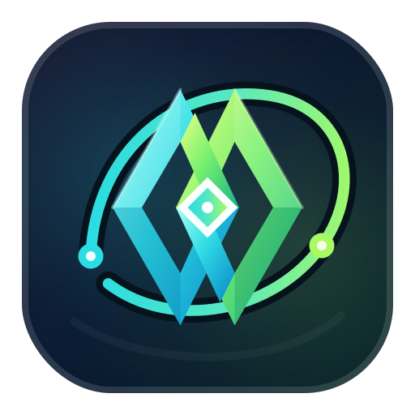
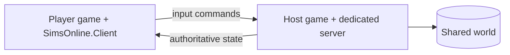

<p align="center">
  
</p>

<h1 align="center">Sims3Online</h1>

<p align="center">
  <strong>Two players. One shared simulation.</strong><br>
  An experimental multiplayer project for <em>The Sims 3</em>.
</p>

<p align="center">
  <a href="https://github.com/ObsidianNetwork/Sims3Online/actions/workflows/build-and-test.yml"></a>
  <a href="https://github.com/ObsidianNetwork/Sims3Online/actions/workflows/docs-check.yml"></a>
  <a href="LICENSE"></a>
  
  
</p>

Sims3Online lets one host-owned game simulate the shared world while each player's own game sends
input and presents the host's results. The goal is a shared native *Sims 3* session rather than two
disconnected replays.

> **Development project, not a player-ready release.** Compatibility and multiplayer behavior are
> limited, and the current network protocol is unauthenticated and unencrypted. Do not expose a
> server to an untrusted network. See [security and known limitations](docs/security.md).
>
> **Naming compatibility note:** The project is branded **Sims3Online**. Solution, project,
> assembly, namespace, and environment-variable identifiers (`SimsOnline.sln`,
> `SimsOnlineServerHostMod`, `SimsOnline.Client`, `SimsOnline.Protocol`, `SIMSONLINE_*`)
> retain `SimsOnline*` for compatibility.

## How it works



The host decides gameplay outcomes; clients mirror state and show the results. Read the
[architecture](docs/architecture.md) and [project overview](docs/overview.md) for the full model.

## Documentation

Full documentation lives in [`docs/`](docs/index.md) and is published at the
[Sims3Online public documentation site](https://obsidiannetwork.github.io/Sims3Online-docs/).

| I want to... | Start here |
| --- | --- |
| Understand the project | [Overview](docs/overview.md), [architecture](docs/architecture.md), [status](docs/status.md) |
| Set up and build | [Developer setup](docs/development.md), [testing](docs/testing.md) |
| Run the server | [Dedicated server CLI](docs/server-cli.md), [troubleshooting](docs/troubleshooting.md) |
| Look up the wire format | [Network protocol](docs/protocol.md), [protocol reference](docs/protocol-reference/index.md) |
| Browse the code | [Components](docs/components.md), [code reference](docs/code-reference/index.md), [repository reference](docs/repo-reference/index.md) |
| Study the simulation | [Simulation reference](docs/simulation-reference/index.md), [architecture deep dive](docs/architecture-deep-dive/index.md) |
| Look something up | [FAQ](docs/faq.md), [glossary](docs/glossary.md) |

To preview the site locally:

```sh
pip install -r requirements-docs.txt
mkdocs serve
```

## Build and test

The public checkout has separate offline and game-backed validation paths. The .NET 8 commands
below build the client, test client, and controller/test project, then run the repository's custom
test runner. They do not launch or require *The Sims 3*:

```sh
dotnet build SimsOnline.Client/SimsOnline.Client.csproj
dotnet build SimsOnline.TestClient/SimsOnline.TestClient.csproj
dotnet build DedicatedServer.Tests/SimsOnline.DedicatedServer.Tests.csproj
dotnet run --project DedicatedServer.Tests/SimsOnline.DedicatedServer.Tests.csproj -- --filter all
```

For the Python lint and test checks used by CI, install the development dependencies with Python
3.12 or later and run:

```sh
python -m pip install -r requirements-dev.txt
python scripts/dev.py check
```

`dev.py check` runs the Python tooling checks; it does not replace the .NET test command above.
Use `python scripts/dev.py test --dotnet` to add the .NET builds and tests to the Python checks.

The host mod's full compile and live scenarios are separate, game-backed validation tiers. A
compatible, legally acquired *The Sims 3* installation is required to run the game. The game and
reference assemblies are not distributed here; compiling the engine-coupled mod sources requires
locally supplied assemblies you are legally permitted to use. See the
[reference assembly policy](refs/sims3/README.md), [developer setup](docs/development.md), and
[testing guide](docs/testing.md) for the boundaries and next steps.

## Contributing

Bug reports and contributions are welcome. Read [CONTRIBUTING.md](CONTRIBUTING.md) and the
[security policy](SECURITY.md) first.

- [Issues](https://github.com/ObsidianNetwork/Sims3Online/issues)
- [Discussions](https://github.com/ObsidianNetwork/Sims3Online/discussions)
- [Code of conduct](CODE_OF_CONDUCT.md)

## Branding and assets

The logo and icon set in [`Assets/`](Assets/README.md) is original artwork by Obsidian Network,
released under the repository's [MIT License](LICENSE). It does not copy EA's plumbob, *The Sims*
wordmark, or official launcher art. The documentation site uses copies of these files under
[`docs/assets/`](docs/assets/).

## License and notices

Code and original artwork are released under the [MIT License](LICENSE).

Sims3Online is an independent, unofficial fan project and is not affiliated with, endorsed by, or
sponsored by Electronic Arts or Maxis. It is unrelated to EA's 2002 game *The Sims Online*. *The
Sims* and *The Sims 3* are trademarks of Electronic Arts Inc.
